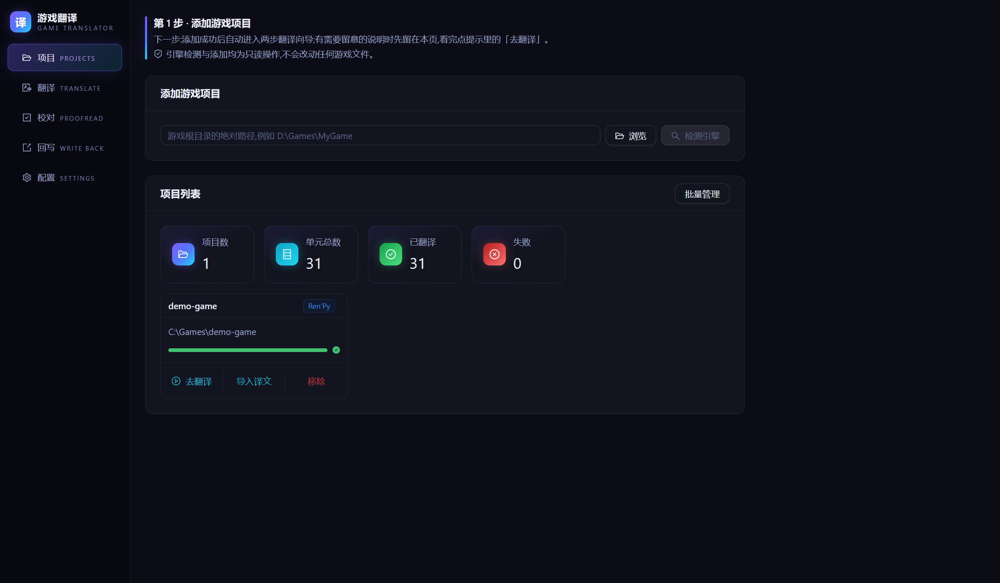
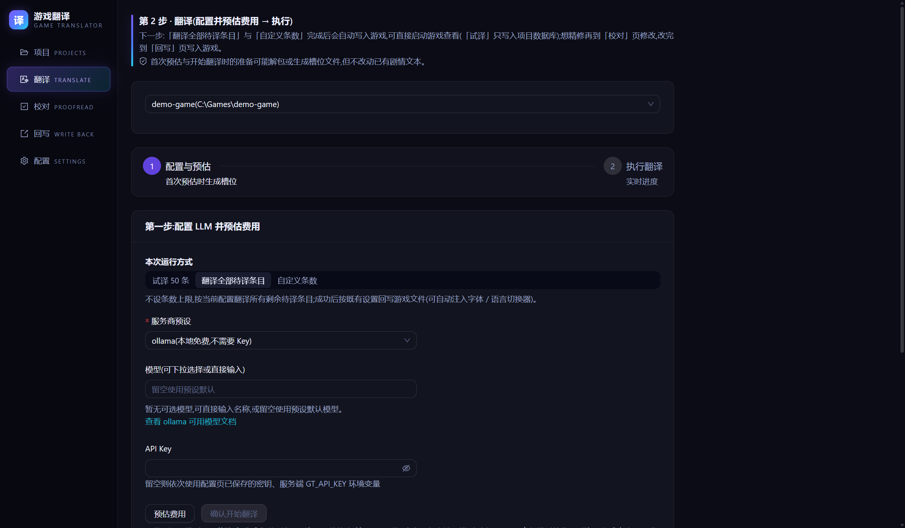
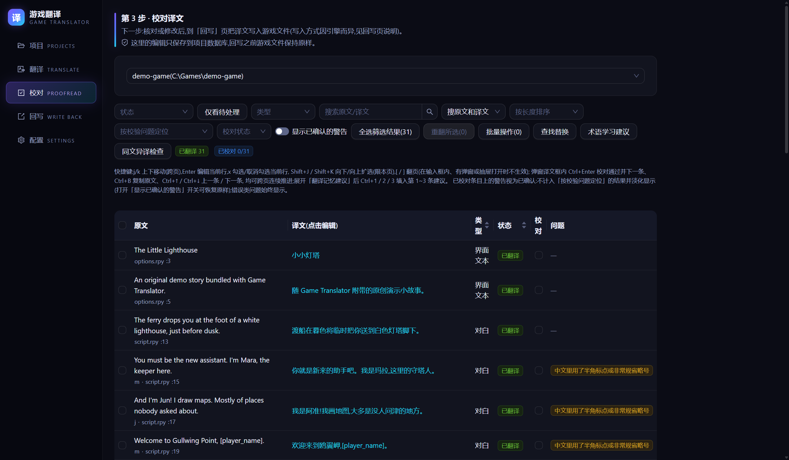

# Game Translator（游戏翻译器）

**把没有中文的游戏汉化成简体中文。** 适合想玩没有中文版的 Galgame、RPG 的玩家：选好游戏文件夹，填上大模型 API Key，工具会自己识别引擎、翻译、写回游戏。支持 13 个引擎：Ren'Py 最完整，CSV / JSONL 表格是需要手动选择的进阶选项，RPG Maker、Unity、KiriKiri 等另外 11 个是实验性；认不出的游戏会直接提示，不会加入。

全部功能免费，没有激活码，也没有付费版。翻译调用的是你自己的模型账号，费用直接付给服务商；用本地 Ollama 则不花钱。

**[下载最新版（Windows，解压即用）](../../releases/latest)** · [快速开始](快速开始.md) · [常见问题](FAQ.md) · QQ 群 1047676453

  
  

## 三步开始

1. **下载解压**：在 [Releases](../../releases/latest) 页面最下方的 Assets 里下载 `GameTranslator-v0.8.0-win64.zip`（不是 Source code，那只是本库的文档），完整解压到 D 盘等普通文件夹（例如 `D:\Games`；别放 `C:\Program Files`，也别放进被 OneDrive 同步的「桌面」「文档」），双击 `GameTranslator` 文件夹里的 `gt.exe`。不用装 Python。
2. **添加游戏**：在项目页选游戏文件夹，工具会自动识别引擎。
3. **开始翻译**：选服务商并填 API Key，先看预估费用，确认后开始。翻完自动写回游戏，然后进游戏玩。

发布包自带一个演示小游戏，可以先拿它试一遍，约 10 分钟：[快速开始](快速开始.md)。翻译自己的游戏时看对应教程：[Ren'Py](教程-RenPy.md)、[RPG Maker](教程-RPGMaker.md)。

**没有 Key？** 智谱 `glm-4.7-flash` 官方标注免费（按账号限并发，有内容审核，成人向文本可能被拒）；DeepSeek 价格较低；本地 Ollama 不用 Key。也支持 OpenAI、Claude、Gemini、xAI 和任何 OpenAI 兼容中转。

## 为什么用它

- **一个程序走完**：识别、解包、提取、翻译、写回都在工具里；Ren'Py 不用装 SDK，RPG Maker 不用另装提取工具（Unity 要先装 XUnity AutoTranslator，见下方引擎说明）。
- **不容易把游戏弄崩**：校验不过的译文会被丢弃、保留原文；回写前自动备份，写入失败整体回滚；多数引擎可一键还原原版（Ren'Py、RPG Maker MV / MZ、Godot 给出手动步骤）。
- **理解引擎**：占位符和控制符翻译前冻结；会让游戏报错的译文字符在写回前拦下或改成全角；可注入中文字体和游戏内语言切换器。
- **费用可控**：运行前预估，可设单次花费上限；断网或被限流时自动暂停，之后接着翻，已翻的不重复收费。
- **译名前后一致**：术语表和角色表分全局与本项目两层，可在翻译前自动抽取术语，也可以给一款游戏写一段翻译规范（人称、口癖、文风）。
- **能校对**：校对页可按问题筛选、批量替换、查看编辑历史；改完再写回游戏。

## 支持的引擎

目前支持 **13 个引擎**，覆盖范围和真机验证程度不同：Ren'Py 最完整，CSV / JSONL 是需要手动选择的进阶选项，其余 11 个都是实验性。

展开查看每个引擎的做法

**一等公民**

- **Ren'Py**：解包（`.rpa`）/ 反编译（`.rpyc`）/ `tl/` 槽位生成 / 中文字体注入 / 语言切换器 / 打成可分发补丁

**通用商业引擎**

- **RPG Maker MV / MZ**（实验性）：加载期按值替换的运行时翻译插件
- **RPG Maker XP / VX / VX Ace**（RGSS）：解包 RGSSAD 归档、就地重写 `Data/` 数据文件，回写时先完整备份归档，再让游戏改读译文（实验性；三代文本均为 UTF-8，简体可直接写入，游戏内能否显示取决于游戏字体；回写前要关闭游戏，备份多占一份归档大小；VX Ace 只在小型测试工程上验证过游戏里的效果，XP / VX 没有样本）
- **Unity**（XUnity AutoTranslator，实验性）：文本翻译 + 引擎版本探测 + 版本特定的 CJK 字体引导
- **Godot 3 / 4**（实验性）：明文 `.tscn` 场景的文本写成 gettext `.po` 译文并注册进 `project.godot`（`.po` 由引擎直接加载；需用与游戏相同版本的 Godot 运行或重新导出工程才会显示中文）
- **Wolf RPG Editor（ウディタ）**（实验性）：地图 / 公共事件 / 数据库文本回写 + 中文字体注入（Wolf RPG 3.5 及更新版本暂不支持，检测时会如实提示）

**日系视觉小说脚本引擎**

- **NScripter / ONScripter**：脚本解码，追加 / 就地回写（输出 UTF-8，已知只有 OnscripterYuri 加 `--enc:utf8` 能正确读取，按上游 README，未真机验证，实验性）
- **KiriKiri / KAG**（实验性）：生成 `patch.xp3` 补丁，由游戏启动脚本加载（明文 xp3，绝不改动源文件；引擎文件解析已真机验证，未进真实游戏）
- **TyranoScript / TyranoBuilder**（实验性）：就地改写 `.ks` 脚本
- **BGI / Ethornell**（Buriko）：DSC 编译脚本解压 + append-and-repoint 回写（实验性；已在一款真实游戏内可视验证简体渲染）
- **Artemis Engine**：`.ast` 对白 + `.tbl` UI 文本 span 精确回写（实验性；`.ast` / `.tbl` 游戏内简体渲染均已真机可视验证）
- **Majiro Script Engine**：MajiroObj 字节码反汇编 + 重打包（实验性；引擎回写正确性已真机实证，游戏内简体显示需非 UTF-8 的 locale 环境）

**通用表格**

- **CSV / JSONL**：通用表格文本（opt-in，不参与自动检测）

## 下载须知

- **GitHub 下载慢或打不开**：见 [FAQ](FAQ.md) 第 75 条（用第三方加速站下载的，务必对照 Releases 正文里的 SHA256）。
- `gt.exe` 离不开同文件夹里的运行库，不要单独拷出来；想放桌面请右键 `gt.exe` →「发送到」→「桌面快捷方式」（Windows 11 要先点「显示更多选项」）。
- **从 v0.7.0 及更早版本升级**：发布物已由单个 exe 改为程序文件夹，旧版的应用内更新会提示「发布资产缺少」，需手动下载一次；之后的版本又可在应用内一键更新。设置、术语表与翻译数据不在程序文件夹里，不受影响。
- **程序没有数字签名**：Windows 可能提示未知发布者，点「更多信息 → 仍要运行」；杀毒软件也可能误报，可把整个 `GameTranslator` 文件夹加入信任（[FAQ](FAQ.md) 第 7 条）。可以这样校验完整性：下载后与同名 `.sha256` 比对（PowerShell：`certutil -hashfile GameTranslator-v0.8.0-win64.zip SHA256`）；解压后 `GameTranslator\checksums.txt` 列出了程序文件夹里每个文件的 SHA256。

遇到问题先看 [FAQ](FAQ.md)。反馈请提 [Issue](../../issues)，翻译失败时附失败任务上的「复制问题报告」，回写后进游戏没变化时附回写页「下载回写摘要(JSON)」下载的文件，其它情况附配置页的「复制诊断信息」；不方便用 GitHub 可以加 QQ 群 1047676453。

## 使用条款

仅供学习与个人使用，请遵守目标游戏的版权与使用条款。本工具只处理引擎的标准归档和通用混淆格式，不破解 DRM，也不支持逐作加密的归档（遇到时识别并提示）。完整条款见 [使用条款与免责声明](使用条款与免责声明.md)。随附的第三方组件及其许可证见程序文件夹内的 `THIRD_PARTY_NOTICES.txt`。

版权方如认为本工具相关内容涉嫌侵权，可通过 GitHub Issues 或爱发电私信（可私下提交材料）联系；我们将在核验权属后按适用规则处理。

## 支持开发

全部功能都免费。如果它帮到了你，可以在[爱发电](https://ifdian.net/a/Dean20030514)赞助开发；赞助完全自愿，不解锁任何功能。

---

_本库只放发布包和使用文档，v2 的源代码未公开。旧版（v1）的完整源码与提交历史保留在 [`v1-archive`](../../tree/v1-archive) 分支。_
