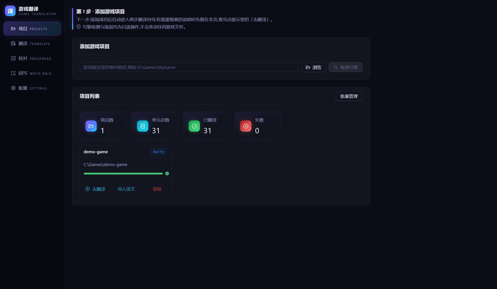
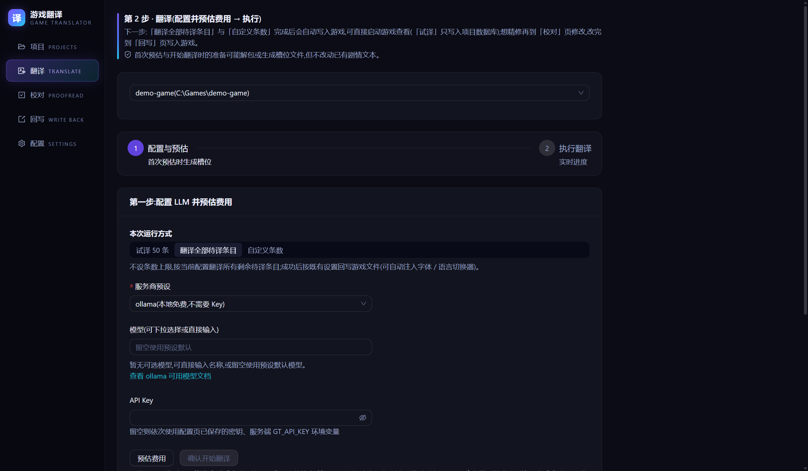
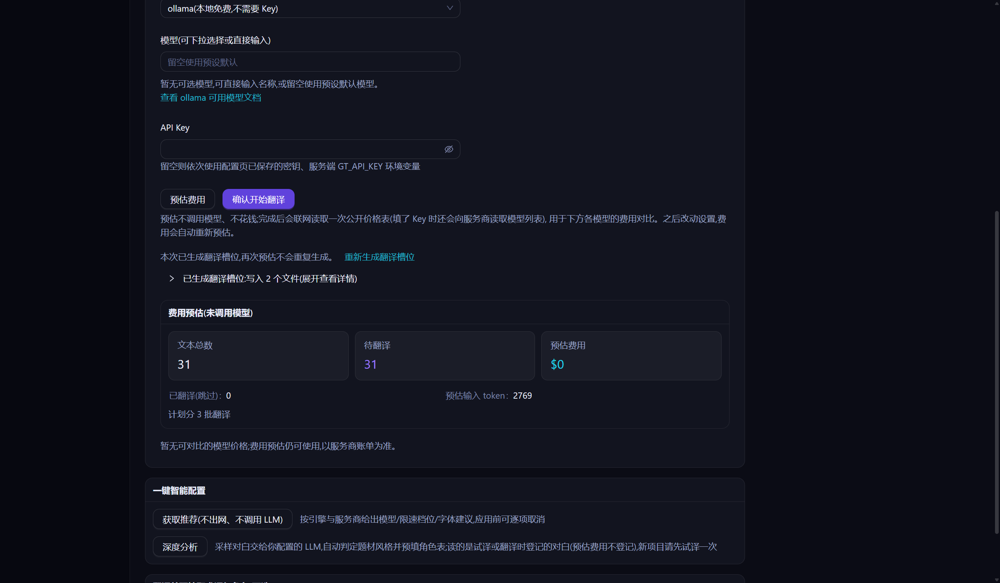
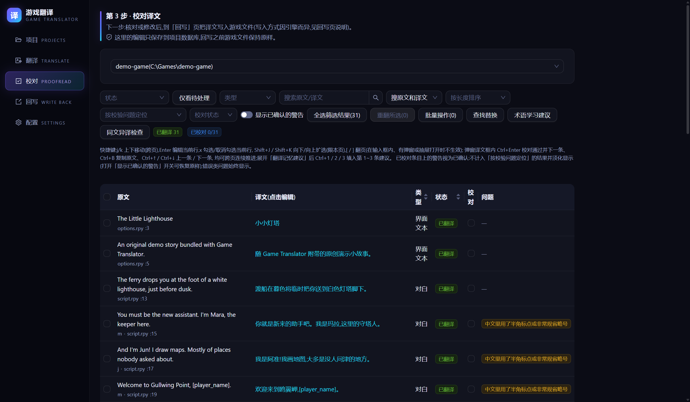
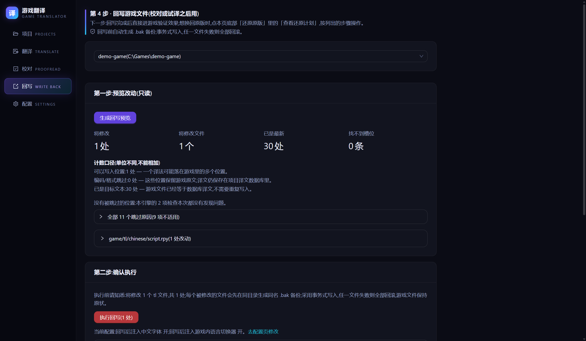

# 快速开始：10 分钟翻译你的第一个游戏

跟着做一遍，用发布包自带的演示游戏《The Little Lighthouse》（`demo-game`
文件夹，原创小故事，随便折腾）完整体验一次翻译闭环。

> 没有 API Key 也能走到第 3 步「预估费用」，先看要花多少钱再决定。
> 推荐 DeepSeek：价格较低，这个 demo 的预估费用通常不到一分钱（以预估页和服务商最新定价为准）。
> 想零成本先试：选智谱预设 `zhipu`，默认模型 glm-4.7-flash 官方标注免费（按账号限并发，有内容审核，成人向文本可能被拒；见 FAQ 第 71 条）。
> Key 输入框下方的「获取 API Key」链接直达各家官方的密钥页面。

---

## 第 1 步：启动（1 分钟）

先把 zip **完整解压**到一个普通文件夹（例如 `D:\Games`），再依次打开解压出来的
`GameTranslator-vX.Y.Z` 和里面的 `GameTranslator` 文件夹，双击 `gt.exe`。

- 用 Windows 自带的「全部解压缩」时，外面可能多一层以压缩包命名的文件夹（如 `GameTranslator-vX.Y.Z-win64`），
  这是正常的，打开它就能看到 `GameTranslator-vX.Y.Z`；第 2 步填路径时也会多这一层，直接点「浏览」选最省事。
- **文件夹里有两个叫 `gt` 的文件**（Windows 默认隐藏扩展名）：双击**类型为「应用程序」**的那个，它就是 `gt.exe`。
  类型为「MS-DOS 应用程序」的是 `gt.com`，给命令行用，双击它会多出一个黑色窗口（FAQ 第 6 条）。
- **不要在压缩软件里直接双击 `gt.exe`**：那样运行的是临时文件夹里的副本，缺文件、关掉压缩软件就没了
  （程序会提示，详见 FAQ 第 27 条）。
- **不要放进 `C:\Program Files`**：那里不允许程序自己写入，一键更新会失败（FAQ 第 28 条）。
  D 盘等普通文件夹都可以；不建议放在 OneDrive 同步的「桌面」「文档」里（第 2 步添加演示游戏时会弹出同步警告，FAQ 第 34 条）。
- `gt.exe` 要和同文件夹里的其他文件放在一起才能运行，**不要把它单独拖出来**；
  想放桌面就右键 `gt.exe`（类型为「应用程序」的那个）→「发送到」→「桌面快捷方式」
  （Windows 11 要先点「显示更多选项」）。
- 双击 `gt.exe` 后直接弹出应用窗口（不会再先弹出黑色控制台窗口）。
- 弹出蓝色的「Windows 已保护你的电脑」（SmartScreen）时：点"更多信息"→"仍要运行"；杀毒软件报毒、
  浏览器下载 zip 时被拦，见 FAQ 第 7 条。
- 应用窗口一片空白、或提示"没有检测到 WebView2"：见 FAQ 第 11 条；弹出「启动失败」对话框：
  见 FAQ 第 25 条。

## 第 2 步：添加项目（1 分钟）

在**项目页**顶部输入框里填入解压目录下 `demo-game` 文件夹的完整路径（它和
`GameTranslator` 程序文件夹并排），例如：

```
D:\Games\GameTranslator-vX.Y.Z\demo-game
```

点**检测引擎**——识别出 Ren'Py 后会直接加入项目列表并进入翻译页，不用再确认；有需要留意的说明时
先留在本页，看完点提示里的**去翻译**。也可以点**浏览**选中 `demo-game` 文件夹，选好就会自动检测并添加。



## 第 3 步：预估费用（2 分钟）

添加后已经在翻译页（没跳转时点提示里或项目卡片上的**去翻译**），直接就是"配置并预估费用"这一步：

1. 服务商预设选 `deepseek`（或免费的 `zhipu`，或你有 Key 的其他服务）。
2. API Key：直接在本页的「API Key」栏填入你的 Key 即可（页面提示"还没有保存 API Key"时也一样）。
   粘贴请用 `Ctrl+V`——应用窗口里右键没有菜单（FAQ 第 6 条）。
   还没保存过 Key 时，填入后下方的「同时保存为默认」默认勾着：开始翻译后先测试连接，通过才连同服务商和模型
   存到本机，之后不用再填；不想保存就取消勾选，这个 Key 只用于本次任务、不写入磁盘。
   也可以先到**配置页**填写并保存 Key（长期有效）。**没有 Key 的话直接做第 3 小步**——预估不需要 Key。
3. 点**预估费用**——立刻显示文本总数、预计 token 与费用。这一步**不花钱**、
   也不会把游戏文本发给 AI；预估完成后会联网取一次公开的价格表，用来对比各模型的费用。
   之后再改服务商、模型或条数，费用会**自动重新预估**（只改 API Key 时除外，再点一次即可）；
   在下方价格表里点某个模型的**使用**也一样。

第一次点**预估费用**时，工具会先在 `demo-game/game/tl/chinese/` 生成"翻译槽位"文件
（原文的中文版会填进这里，**你的游戏源脚本一个字都不会被改**），再给出预估；
生成结果折叠在按钮下方，可展开查看。以后需要重做时点**重新生成翻译槽位**即可。

翻自己的游戏时，想让角色名和专有名词前后一致，可以用这一页下方可选的「翻译前预抽取术语与角色」。
它会调用模型，开始前先显示预计费用，结果逐条确认后才写进术语表。打包的游戏要先点一次**预估费用**，它才看得到文本。





## 第 4 步：开始翻译（1 分钟）

「本次运行方式」默认是**翻译全部待译条目**。有 Key 就点**确认开始翻译**，看实时进度条跑完
（demo 约半分钟）。

**翻译完成后会自动写入游戏**：对 Ren'Py 来说，就是把译文写进 `game/tl/chinese/`，并按配置页的
设置注入中文字体和游戏内语言切换器（默认都开）。写入前自动 `.bak` 备份，失败整体回滚。
结果区会显示「已写入游戏，可直接启动游戏查看」，下面列出这个引擎「还需要你做」的事。

> 想先小范围看看效果：运行方式选「**试译 50 条**」。试译只把译文写入项目数据库，**不改游戏文件**；
> 满意后点「继续全部待译」翻完剩下的（已译条目不会重复收费），或到回写页把试译结果写进游戏。

## 第 5 步：验收（1 分钟）

打开 `demo-game/game/tl/chinese/script.rpy`——中文译文已经在里面了。

> 在真实游戏里，直接启动游戏即可：配置页「高级设置」→「引擎专项设置」里的「Ren'Py 首次启动显示中文」默认开着，第一次启动就显示中文。
> 以前在这台电脑上启动过这个游戏、或游戏自己设了默认语言时，会沿用原来的语言，切一次即可：
> 进游戏打开「设置 / Preferences」，在右下角「Language 语言」下点 `chinese`——这组按钮是工具自动加的。
> 看不到这组按钮时见 FAQ 第 9 条。

## 第 6 步（可选）：校对精修（2 分钟）

机器翻译之后人工过一遍，质量会好很多。左侧菜单进**校对页**：31 条译文全部列出。

- 点任意一条**译文**打开编辑弹窗，改改试试（比如把"你就是新来的助手吧。"改成你喜欢的语气），
  然后点**保存**，或点**校对通过，下一条**保存并跳到下一条。不点保存就关弹窗，修改不会保存
  （关之前会先问你）。
- 注意译文里的 `[player_name]`、`{b}` 这类标记是游戏变量和格式标签，
  **不要删改**——工具的校验也会替你把关。
- 校对页的修改**只保存在项目数据库里**，要做完下一步才会进游戏。



## 第 7 步（可选）：把校对的修改写回游戏（2 分钟）

改过译文之后（或者用的是试译），左侧菜单进**回写页**：

1. 页面一打开就会自动生成**回写预览**——只读分析，列出"将修改 N 处"和涉及的文件，不改任何文件。
2. 页面上有一行显示当前的字体和语言切换器注入设置（默认都开），要改点**去配置页修改**。
3. 点红色的**执行回写**并确认——写入前自动 `.bak` 备份，失败整体回滚。



写完再打开 `demo-game/game/tl/chinese/script.rpy`，你刚校对过的中文已经在里面了。

## 遇到问题

| 你看到的 | 怎么办 |
|---|---|
| 翻译报错或连接失败 | 已翻好的条目都已保存，不用重翻。Key、地址或模型名可能填错了，到**配置页**点「测试连接」看原因（FAQ 第 4 条）。任务失败时，先点结果区的「复制问题报告」，再点「反馈问题」贴进去（FAQ 第 24 条） |
| 其他问题 | 先查 FAQ 开头的症状索引 |

---

## 完成！接下来翻译你自己的游戏

流程完全一样：项目页添加你的游戏目录（`game/` 里有 `.rpy` 文件，或脚本打包在 `.rpa` 里、只有 `.rpyc` 都可以，
见 FAQ 第 13 条）→ 预估费用 → 翻译（完成后自动写入游戏）→ 进游戏验收；
想精修再校对 → 回写。

建议先用**配置页**把 API Key 和术语表（角色名固定译法）存好，
之后每个项目都自动套用。

按引擎的详细步骤和常见的坑见[《Ren'Py 教程》](教程-RenPy.md)和[《RPG Maker 教程》](教程-RPGMaker.md)。
