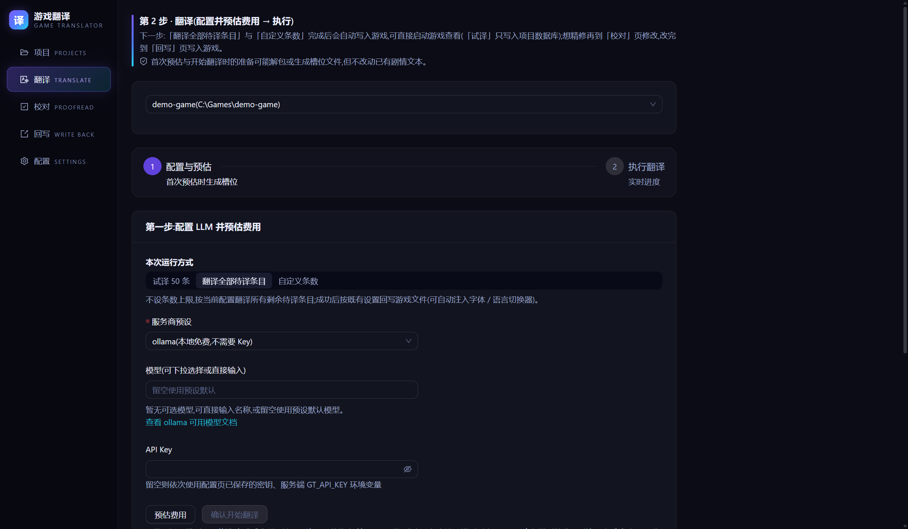

# RPG Maker 游戏汉化教程

## 你将完成

把一个 RPG Maker 游戏翻译成简体中文，并在游戏里看到中文。

流程：分清游戏是哪一代 → 添加游戏 → 预估费用 → 翻译 → 进游戏检查 →（可选）校对后再写入一次。

RPG Maker 支持目前是**实验性**的。VX Ace 只在小型测试工程上验证过游戏里的效果，XP 和 VX 还没有用真实游戏验证过。翻译前建议先试译，翻译后一定进游戏看一遍。

第一次用这个工具，建议先跟着[快速开始](快速开始.md)用演示游戏走一遍。

## 开始前

- 已经完整解压 GameTranslator，能打开 `gt.exe`。
- 一个大模型的 API Key。没有也能走到「预估费用」这一步，怎么选见[快速开始](快速开始.md)。
- 建议用一份干净的游戏：没有被其他汉化工具或 MTool 改过。本工具不检查这一点。
- 建议先把游戏文件夹复制一份，出问题时直接换回去。

## 先分清游戏是哪一代

两类游戏的写入方式不同，后面的按钮名也不同。

| | MV / MZ | XP / VX / VX Ace |
|---|---|---|
| 怎么认 | 有 `data/System.json`（MV 打包后可能在 `www/data/`） | `Data/` 里有 `.rxdata`（XP）、`.rvdata`（VX）、`.rvdata2`（VX Ace），或根目录有 `Game.rgssad`、`Game.rgss2a`、`Game.rgss3a` |
| 译文写到哪 | 新增译文表和翻译插件，原来的 `data/*.json` 不改 | 直接改写 `Data/` 里的数据文件，改之前先备份 `.bak` |
| 中文字体 | 自动放进游戏 | **不放**，可能显示方块 |
| 对白太长 | 提示，也可以打开自动折行 | 只提示 |
| 「回写」页的按钮 | 「注入翻译插件」 | 「执行回写(N 处)」 |
| 撤销 | 手动 | 「还原原版」 |

## 步骤

### 第 1 步：添加游戏

1. 点左侧菜单「项目」。
2. 点「浏览」，选游戏的主文件夹（通常有 `Game.exe`）。也可以把路径粘到输入框，再点「检测引擎」。
3. 识别成功后会自动进入翻译页。页面上有黄色说明时，先看完，再点「去翻译」。XP / VX / VX Ace 总会有这段说明。

MV 的数据在 `www/` 下时，工具会自己找到，不用选到 `www` 里面。

看到「未识别到支持的游戏引擎」时，先确认文件夹里有 `data` 或 `Data`。如果整个游戏被封装进了 exe（比如 Enigma Virtual Box），文件夹里就没有这些数据。本工具不解这类封装。

### 第 2 步：预估费用

1. 在「第一步:配置 LLM 并预估费用」里选「服务商预设」，填「API Key」。
2. 点「预估费用」。这一步不花钱，也不会把游戏文本发给 AI。
3. 看页面上的文本总数和预计费用，再决定要不要继续。

（可选）想让角色名和专有名词前后一致，可以用这一页下方的「翻译前预抽取术语与角色」。它会调用模型，开始前先显示预计费用，结果逐条确认后才写进术语表。打包的 XP / VX / VX Ace 游戏，要先点一次「预估费用」，它才看得到文本。

### 第 3 步：翻译

1. 在「本次运行方式」里选一种：
   - 「试译 50 条」：先看效果。译文只存进项目数据库，不写游戏文件。
   - 「翻译全部待译条目」：翻完自动写入游戏。
   - 「自定义条数」：在「最多处理 N 条待译条目」里填本次上限，翻完同样自动写入游戏。
2. 点开始按钮（试译是「确认开始试译(最多 50 条)」，另外两种是「确认开始翻译」）。
3. 等进度条跑完。写入成功时，结果区显示「已写入游戏,可直接启动游戏查看(先看下面「还需要你做」)」。

试译满意后，点「继续全部待译」翻完剩下的。已译条目不会重复收费。

### 第 4 步：进游戏检查

RPG Maker 不需要切换语言，直接启动游戏。

走到几段对白、打开菜单看一看。工具里检查通过，不等于游戏里一定显示正确。

### 第 5 步（可选）：校对后再写入一次

1. 点左侧菜单「校对」。
2. 点一条译文，修改后点「保存」，或点「校对通过,下一条」。
3. `\C[2]`、`\V[1]`、`%1` 这类控制符不要删改。译文丢了控制符时，工具不会采用这条译文。
4. 校对的修改只存在项目数据库里，要写入一次才会进游戏：
   - MV / MZ：点左侧菜单「回写」，再点「注入翻译插件」（之后叫「重新注入翻译插件」）。可以重复点，结果不会叠加。
   - XP / VX / VX Ace：点左侧菜单「回写」，看过预览后点「执行回写(N 处)」并确认。

## MV / MZ 要知道的事

**写入了什么**（MV 打包版都在 `www/` 下）：

- `data/gt_translation.json`：译文表。不要手改，下次写入会覆盖。要改译文请用「校对」页。
- `js/plugins/Translation_MV.js` 或 `Translation_MZ.js`：翻译插件。
- `fonts/` 里的 `NotoSansSC-Regular.ttf` 和 `gt_OFL.txt`：中文字体及其许可证。字体约 10 MB。
- `js/plugins.js`：加一行，启用翻译插件。第一次改之前备份成 `js/plugins.js.bak`。

**同一句原文只有一个译文**。插件按原文替换，全游戏同样的句子都用排在最前的那条译文。校对时改了后面的同句，游戏里可能不变。

**对白太长**：会提示超宽的行数，校对页可以按「单行估算超出对话框宽度」筛出来。也可以到「配置」→「高级设置」→「引擎专项设置」，展开 RPG Maker，打开「回写时自动折行超宽对白」并点「保存配置」，再注入一次。宽度是估算的，改过分辨率或字号的游戏可能不准。带 `<WordWrap>` 的对白由游戏的消息插件排版，自动折行不处理，提示超宽时请缩短译文。

**旧存档**：读旧存档时，角色名、称号和简介也显示译文。你自己改过的名字不受影响，存档本身不会被修改。存档时正在进行的事件，到它结束前还是原文。详见 [FAQ](FAQ.md) 第 70 条。

**撤销**（暂不支持自动还原，顺序不能反）：

1. 在 `js/plugins.js` 里把 `Translation_MV` 或 `Translation_MZ` 那一条的 `status` 改成 `false`，或删掉这一条。
2. 再删除 `js/plugins/Translation_M*.js`、`data/gt_translation.json`，以及 `fonts/` 里工具放入的字体和 `gt_OFL.txt`。

只删插件文件的话，游戏启动会报「Failed to load」。详细说明见 [FAQ](FAQ.md) 第 10 条。

## XP / VX / VX Ace 要知道的事

**写入了什么**：直接改写 `Data/` 里的数据文件。每个文件第一次改之前，在旁边备份成 `.bak`。写完会重新读取校验，任一文件失败就全部回滚。

**打包的游戏**（根目录有 `Game.rgssad`、`Game.rgss2a` 或 `Game.rgss3a`）：

- 第一次点「预估费用」时，工具把数据文件解到 `Data/`。这一步不改动归档。归档损坏时什么也不会解出，页面会说明原因，见 [FAQ](FAQ.md) 第 58 条。
- 引擎优先读归档。所以写入译文前，工具会先把归档完整备份成 `.bak`（比如 `Game.rgss3a.bak`），再让游戏改读翻译后的数据文件。图片和音频仍从归档读。「回写」页的预览会列出归档，并提示这份备份。
- 这份备份多占一份归档大小。大游戏可能要几百 MB 到几 GB，开始前看一眼磁盘空间。
- 写入前先关闭游戏。游戏开着或磁盘放不下备份时，游戏数据完全不会被改动：
  - 在「回写」页，报错是「没有改动游戏数据:…请关闭游戏,确认磁盘放得下一份归档备份后重新回写」。
  - 翻译完自动写入时，报错是「写回译文到游戏文件失败(游戏可能正开着,或磁盘已满、无写入权限);译文已保存,可以到回写页重试」。译文已经保存，不用重新翻译。
  - 两种情况都这样处理：关掉游戏，腾出磁盘空间，到「回写」页点「执行回写(N 处)」重试。
- 游戏更新过、归档里的数据和工具解出的版本不一样时，工具不会让游戏改读这些文件，并提示「这些文件的改动不会生效」。见 [FAQ](FAQ.md) 第 46 条。
- 「试译」不写游戏文件，也不碰归档。
- 用旧版本汉化过、进游戏还是原文的游戏，重新「执行回写(N 处)」一次即可。旧版汉化之后游戏又更新过的，先看 [FAQ](FAQ.md) 第 48 条，直接回写会把更新前的文件写回去。
- 只有 VX Ace 在真实引擎上验证过（用小型测试工程）。XP 和 VX 同样处理，未在真实游戏上验证。

**字体**：本工具不向这几代游戏放字体。三代的文本都是 UTF-8，简体中文能写入，但能不能显示取决于游戏字体。日文游戏的字体常缺简体字，VX Ace 默认字体 VL Gothic 缺约三成常用简体字。中文显示成方块时，译文其实已经写入，需要你自己给游戏换一个含简体字的字体。做法因游戏而异，本教程没有通用步骤。

**对白太长**：只提示，不会自动换行。校对页可以按「单行估算超出对话框宽度」筛出来，再缩短译文。

**旧存档**：读旧存档时当前地图会重新载入并显示译文（VX Ace 在引擎上用默认脚本实测过；XP、VX 只读过脚本），效果和重新走进这张地图一样，事件回到初始位置。存档里的角色名还是原文，开新档才变。详见 [FAQ](FAQ.md) 第 70 条。

**撤销**：点左侧菜单「回写」，在「还原原版」里点「查看还原计划」，看过计划后点「还原原版」，再点「确认还原」。它用 `.bak` 换回原版数据文件，并让游戏重新从归档读取。所有 `.bak` 都会保留，归档的备份想删要你自己删。从归档解出的 `Data/` 不会被删除。

## 哪些内容不翻译

这些地方常被程序当作标识读取，翻了可能让游戏功能失效，所以工具不碰：

- **插件参数**：`js/plugins.js` 里每个插件的设置。很多插件自带的菜单文字、任务界面文字都放在这里，会保持原文。
- **插件命令和脚本**：事件里的插件命令、脚本命令，以及 XP / VX / VX Ace 的 Scripts（Ruby 代码）。
- **备注和注释**：数据库的备注栏（note）、事件注释。
- **开关名和变量名**。
- **图片里的文字**。

XP 和 VX 的部分系统词条（比如菜单项）目前也不提取，会保持原文。

所以汉化后界面上还有原文，多半来自上面这些地方，不是翻译失败。

## 遇到问题

| 你看到的 | 怎么办 |
|---|---|
| MV / MZ 进游戏还是原文 | 确认 `js/plugins.js` 里翻译插件那一条的 `status` 是 `true`。用的是试译，或校对后没写入时，到「回写」页注入 |
| MV / MZ 提示检测到自带的本地化框架 | 这类游戏从自己的语言库取文字，会绕过翻译插件，游戏里可能不显示中文。先试译，再进游戏确认 |
| MV / MZ 提示 `js/plugins.js` 无法解析 | 工具不会动这个文件，要你手动启用插件 |
| 启动报「Failed to load」 | 只删了插件文件。见上面的撤销步骤 |
| XP / VX / VX Ace 中文显示成方块 | 见上面「字体」 |
| XP / VX / VX Ace 提示「没有改动游戏数据」或「写回译文到游戏文件失败」 | 游戏数据没动，译文也已保存。关掉游戏，确认磁盘放得下一份归档备份，到「回写」页点「执行回写(N 处)」重试 |
| XP / VX / VX Ace 提示「这些文件的改动不会生效」 | 游戏更新过，归档里是新版本。见 [FAQ](FAQ.md) 第 46 条 |
| 提示「RGSSAD 归档……已损坏或不完整」 | 重新下载或校验游戏文件。见 [FAQ](FAQ.md) 第 58 条 |
| 回写提示文件被其他程序改动过 | 见 [FAQ](FAQ.md) 第 48 条 |
| 翻译中途停了（取消、出错，或程序被关掉） | 回到「翻译」页选这个项目，页面顶部会说明上次翻译是怎么停的，点「一键续跑」。改过页面上的设置时不显示这个按钮，照常点「确认开始翻译」也一样。已翻好的条目都会跳过，只对剩余部分计费 |
| 翻译报错或连接失败 | 已翻好的条目都已保存，不用重翻。Key、地址或模型名可能填错了，到「配置」页点「测试连接」看原因，见 [FAQ](FAQ.md) 第 4 条。任务失败时，先点结果区的「复制问题报告」，再点「反馈问题」贴进去，见 [FAQ](FAQ.md) 第 24 条 |
| 游戏出了新版本 | 已翻好的译文可以接回。见 [FAQ](FAQ.md) 第 46 条 |

## 常见问题

**图片和音频加密了，能翻译吗？**

能翻译文字。工具读的是数据文件，MV / MZ 的图片和音频加密不影响它。图片里的字翻不到。

**翻译后的游戏还需要这个工具吗？**

不需要。译文已经写进游戏文件夹。

**可以把翻好的游戏分享给别人吗？**

XP / VX / VX Ace 的输出包含游戏原始内容，不能作为补丁传播。其他情况见 [FAQ](FAQ.md) 第 21 条。

## 相关文档

- [快速开始](快速开始.md)
- [Ren'Py 游戏汉化教程](教程-RenPy.md)
- [FAQ](FAQ.md)
