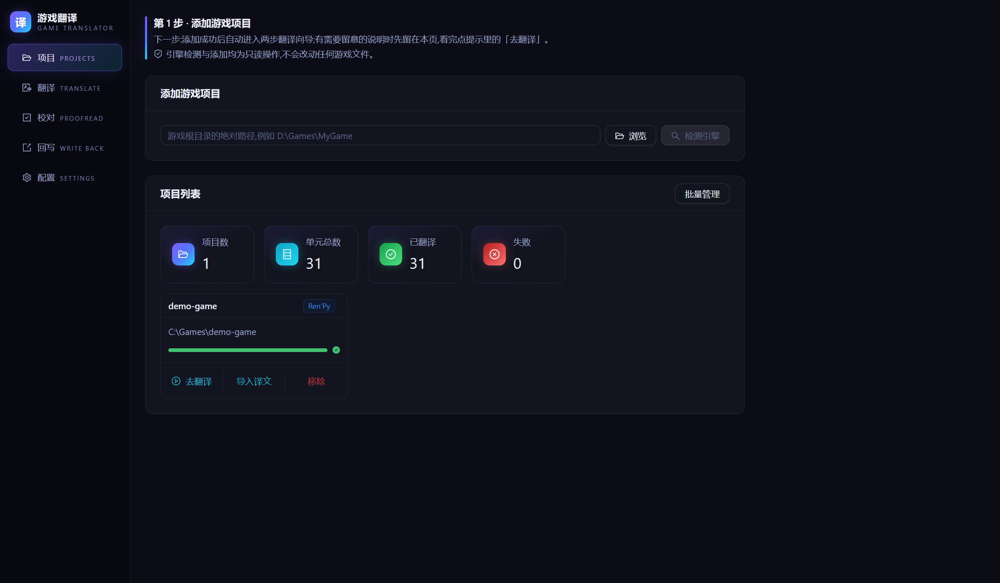
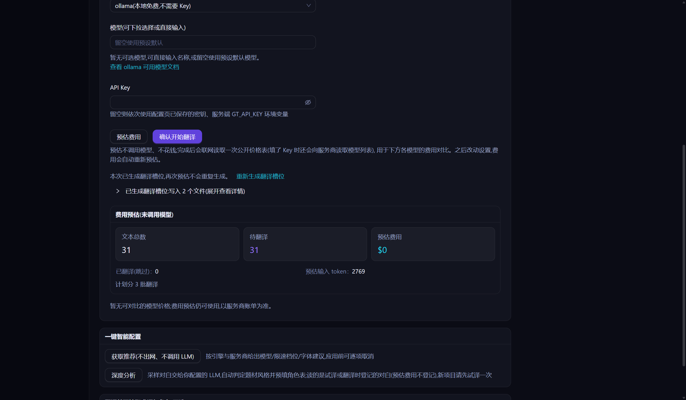

# Ren'Py 游戏汉化教程

## 你将完成

把一个 Ren'Py 游戏翻译成简体中文，并在游戏里看到中文。

流程：添加游戏 → 预估费用 → 翻译 → 进游戏切到中文 →（可选）校对后再写入一次。

第一次用这个工具，建议先跟着[快速开始](快速开始.md)用演示游戏走一遍。

## 开始前

- 已经完整解压 GameTranslator，能打开 `gt.exe`。
- 一个大模型的 API Key。没有也能走到「预估费用」这一步，怎么选见[快速开始](快速开始.md)。
- 确认是 Ren'Py 游戏：游戏文件夹里有一个 `game` 文件夹，里面有 `.rpy`、`.rpyc` 或 `.rpa` 文件。
- 建议用一份干净的游戏：没有被其他汉化工具或 MTool 改过。本工具只会提示已有的编译版 `chinese` 翻译，其他改动不检查。
- 建议先把游戏文件夹复制一份，出问题时直接换回去。

## 步骤

### 第 1 步：添加游戏

1. 点左侧菜单「项目」。
2. 点「浏览」，选游戏文件夹。要选**里面有 `game` 文件夹的那一层**，不是 `game` 本身。也可以把路径粘到输入框，再点「检测引擎」。
3. 识别成功后会自动进入翻译页。页面上有黄色说明时，先看完，再点「去翻译」。

选错一层时，工具会提示正确的目录，点「改用并添加」即可。

游戏脚本的存放方式不同，工具的做法也不同：

| 你的游戏 | 工具怎么做 | 你要做什么 |
|---|---|---|
| `game` 里有 `.rpy` | 直接翻译 | 不用做 |
| `.rpa` 归档里有 `.rpy` | 第一次预估费用时，把脚本解到游戏目录下的 `.gt/unpacked/`，不写进 `game` | 不用做 |
| 只有 `.rpyc`（散放或在 `.rpa` 里） | 提示可以反编译。在工具内还原，不运行游戏代码，结果放在 `.gt/decompiled/`，不改游戏文件 | 确认你有权操作这个游戏，点「反编译为 .rpy 并添加」，再点「我已确认,开始反编译」 |
| 加密的 `.rpa`，或读不出任何脚本 | 提示无法翻译，不会加入项目 | 本工具不支持这类游戏 |

部分作者禁止反编译，请先确认。无法完整还原的脚本会被跳过并说明原因，其中的对白不会被翻译。

### 第 2 步：预估费用

1. 在「第一步:配置 LLM 并预估费用」里选「服务商预设」，填「API Key」。
2. 点「预估费用」。这一步不花钱，也不会把游戏文本发给 AI。
3. 看页面上的文本总数和预计费用，再决定要不要继续。

（可选）想让角色名和专有名词前后一致，可以用这一页下方的「翻译前预抽取术语与角色」。它会调用模型，开始前先显示预计费用，结果逐条确认后才写进术语表。脚本打包在 `.rpa` 里的游戏，要先点一次「预估费用」，它才看得到文本。

第一次点「预估费用」时，工具会在 `game/tl/chinese/` 生成翻译槽位文件，也就是之后放中文的位置。游戏原来的脚本不会被改。

### 第 3 步：翻译

1. 在「本次运行方式」里选一种：
   - 「试译 50 条」：先看效果。译文只存进项目数据库，不写游戏文件。
   - 「翻译全部待译条目」：翻完自动写入游戏。
2. 点开始按钮（试译是「确认开始试译(最多 50 条)」，全部翻译是「确认开始翻译」）。
3. 等进度条跑完。写入成功时，结果区显示「已写入游戏,可直接启动游戏查看(先看下面「还需要你做」)」。

试译满意后，点「继续全部待译」翻完剩下的。已译条目不会重复收费。

默认设置下，写入游戏时只新增这些文件，不改游戏原有文件：

- `game/tl/chinese/`：译文。
- `game/zz_tl_font_inject.rpy` 和 `game/fonts/` 里的字体、`gt_OFL.txt`：让中文能显示。
- `game/zz_tl_language_switcher.rpy`：在游戏设置界面加语言按钮。
- `game/zz_tl_default_language.rpy`：让游戏第一次启动就显示中文。

### 第 4 步：进游戏切到中文

Ren'Py 的原文和译文同时存在，游戏显示哪种语言要看设置。

**第一次打开这个游戏**：默认直接显示中文，不用操作。

**下面两种情况仍显示原文，需要手动切一次**：

- 这台电脑上已经启动过这个游戏，Ren'Py 会沿用上次的语言。
- 游戏自己设了默认语言，或者会按系统语言自动选择。

**手动切换**：

1. 在游戏里打开设置界面（「设置」或「Preferences」）。
2. 找到右下角的「Language 语言」。
3. 点 `chinese`。

点 `Default` 可以切回原文。语言会被记住，下次不用再切。游戏自带的其他语言也会列在这里。

写入时游戏还开着的话，要重启游戏才能看到。

### 第 5 步（可选）：校对后再写入一次

机器翻译会有错，建议人工过一遍。工具里检查通过，也不等于游戏里一定显示正确，要进游戏确认。

1. 点左侧菜单「校对」。
2. 点一条译文，修改后点「保存」，或点「校对通过,下一条」。
3. `[player_name]`、`{b}` 这类标记是游戏变量和格式标签，不要删改。
4. 校对的修改只存在项目数据库里。改完点左侧菜单「回写」，看过预览后点「执行回写(N 处)」并确认。

写入前会自动备份，失败会整体回滚。

### 第 6 步（可选）：分享或撤销

**分享**：「回写」页的「生成汉化补丁(.rpa)」会打包翻译产物。分享前请先看 [FAQ](FAQ.md) 第 21 条，确认游戏的授权条款允许。

**撤销**：Ren'Py 暂不支持自动还原，按下面做：

1. 删除 `game/tl/chinese/`。
2. 删除 `game/` 下以 `zz_tl_` 开头的文件。
3. 删除 `game/fonts/` 里工具放入的字体和 `gt_OFL.txt`，该目录原有的字体要保留。
4. 「注入方式」选过「静态」的，把 `game/gui.rpy.bak` 改名回 `game/gui.rpy`。

详细说明见 [FAQ](FAQ.md) 第 10 条。

## 遇到问题

| 你看到的 | 怎么办 |
|---|---|
| 进游戏还是原文 | 按第 4 步切一次。用的是试译，或校对后没写入时，到「回写」页点「执行回写(N 处)」。见 [FAQ](FAQ.md) 第 9 条 |
| 切到中文后，读档或重启又退回原文 | 游戏可能用 `define config.language` 强制了语言。到「配置」→「高级设置」→「引擎专项设置」，确认 Ren'Py 分组的「Ren'Py 首次启动显示中文」已开启，点「保存配置」，再到翻译页点「预估费用」，在「本次运行方式」选「翻译全部待译条目」，点「确认开始翻译」（已翻译的条目会自动跳过；还有未译条目时，这些条目会被翻译并计费）。「试译」不写游戏文件，「回写」页没有改动时按钮不能点，这一步都用不上。已经启动过这个游戏的，还要按第 4 步切一次 |
| 翻译报错或连接失败 | 已翻好的条目都已保存，不用重翻。Key、地址或模型名可能填错了，到「配置」页点「测试连接」看原因，见 [FAQ](FAQ.md) 第 4 条。任务失败时，先点结果区的「复制问题报告」，再点「反馈问题」贴进去，见 [FAQ](FAQ.md) 第 24 条 |
| 设置界面没有语言按钮 | 游戏可能用了自己的设置界面，按钮也可能被挡住。到 [FAQ](FAQ.md) 第 9 条用控制台切换 |
| 中文显示成方块 | 到「配置」→「高级设置」→「中文字体注入」，确认已开启。默认的「运行时(推荐)」无效时，把「注入方式」改成「静态」，点「保存配置」，再到翻译页点「预估费用」，在「本次运行方式」选「翻译全部待译条目」，点「确认开始翻译」（已翻译的条目会自动跳过；还有未译条目时，这些条目会被翻译并计费）。静态方式会改写 `game/gui.rpy`，改之前会先备份 `.bak` |
| 预估时停止，提示已有编译好的翻译 | 游戏里已有编译好的 `chinese` 翻译。见 [FAQ](FAQ.md) 第 49 条 |
| 提示反编译结果已过期 | 游戏更新过。见 [FAQ](FAQ.md) 第 51 条 |
| 旧存档还能读吗 | 能，回到存档时那一句，切到中文后显示中文。见 [FAQ](FAQ.md) 第 70 条 |
| 游戏出了新版本 | 已翻好的译文可以接回。见 [FAQ](FAQ.md) 第 46 条 |

## 常见问题

**哪些内容翻译不到？**

- 图片里的文字。
- 写在 Python 代码里、没有用 `_()` 标记的文字。工具会翻译对白、菜单、界面的 `text` / `textbutton` / `label` / `tooltip`、`_()` 标记的文字，以及 `Notify("...")`、`Text("...")`、`renpy.input`、`renpy.confirm`、`Confirm` 的提示文字。存档与退出确认、存档位日期、无障碍菜单这些引擎自带的界面文字也会翻译（每个游戏多约 300 条短句，预估费用已包含）。
- 游戏自带的其他语言。工具翻译的是脚本里的原文。

**角色名没有翻译？**

`"路人" "你好"` 这种直接写在对白前的名字默认就翻。`define e = Character("Eileen")` 这种没有标记为可翻译的角色名默认不翻：到「配置」→「高级设置」→「引擎专项设置」，展开 Ren'Py，打开「翻译未标记的角色名」并点「保存配置」。再到翻译页点「重新生成翻译槽位」，然后翻译。

**中文字体会影响原文显示吗？**

会。字体替换对所有语言生效，切回 `Default` 也用这个字体。图标字体会跳过，但原字体独有的符号可能显示不出来。

**游戏里有 `.rpe` 或 `.rpi` 文件？**

这是一些游戏带的扩展或保护文件。本工具没有专门处理，也没有验证过，结果要以进游戏看到的为准。

**翻译后的游戏还需要这个工具吗？**

不需要。译文已经写进游戏文件夹。

## 相关文档

- [快速开始](快速开始.md)
- [RPG Maker 游戏汉化教程](教程-RPGMaker.md)
- [FAQ](FAQ.md)
